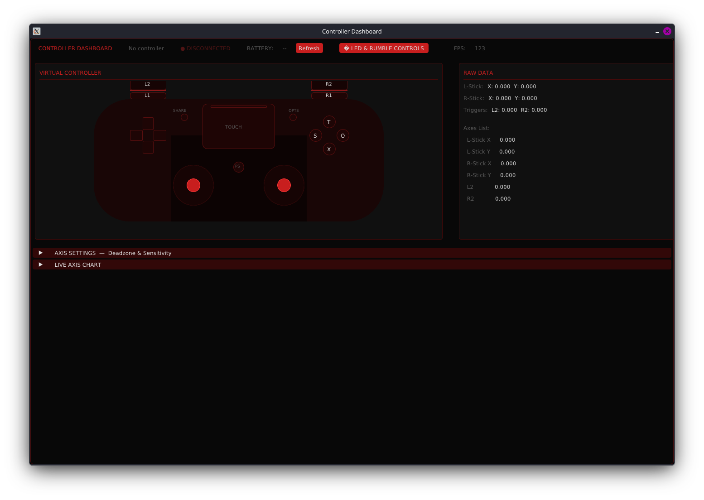

<div align="center">

```text
========================================================================================
███████╗ █████╗ ███╗   ██╗███████╗    ███╗   ███╗███████╗ ██████╗  █████╗ ██████╗ ██████╗ 
╚══███╔╝██╔══██╗████╗  ██║██╔════╝    ████╗ ████║██╔════╝██╔════╝ ██╔══██╗██╔══██╗██╔══██╗
  ███╔╝ ███████║██╔██╗ ██║█████╗      ██╔████╔██║█████╗  ██║  ███╗███████║██████╔╝██████╔╝
 ███╔╝  ██╔══██║██║╚██╗██║██╔══╝      ██║╚██╔╝██║██╔══╝  ██║   ██║██╔══██║██╔═══╝ ██╔═══╝ 
███████╗██║  ██║██║ ╚████║███████╗    ██║ ╚═╝ ██║███████╗╚██████╔╝██║  ██║██║     ██║     
╚══════╝╚═╝  ╚═╝╚═╝  ╚═══╝╚══════╝    ╚═╝     ╚═╝╚══════╝ ╚═════╝ ╚═╝  ╚═╝╚═╝     ╚═╝     
               CORE MATRIX // RUST EDITION // HARDWARE GOVERNOR
========================================================================================
```

# ZANE MEGAPP [RUST]
### Next-Gen Native System Matrix, Thermal Telemetry & Controller Space Cockpit

[](https://www.rust-lang.org)
[](https://github.com/emilk/egui)
[](https://crates.io/crates/egui_plot)
[](#hardware-specs)
[](#display--compositor)
[](#privilege-architecture)

<br/>


<br/>

### Controller Space Integration & Live Deck


<br/>

---

</div>

## OVERVIEW

ZaneMegApp (V4 Architecture) is an ultra-low-latency, zero-overhead Rust rewrite of the monolithic telemetry console. Built on `eframe` (egui 0.36) and `egui_plot` (0.37), it replaces legacy interpreted scripts with a multi-threaded, GPU-accelerated binary engineered for sub-millisecond dispatch, locked 60 FPS viewport rendering, and kernel-level hardware governors.

Engineered specifically for high-intensity hardware tuning on the MSI GF65 Thin and compatible Linux battle-stations, ZaneMegApp interfaces with embedded controller registers, real-time thermal curves, battery wear governors, asynchronous process scavengers, and direct IPC launch vectors for [Controller Space](https://github.com/ZaneGoat/Controler-space).

```text
+----------------------------------------------------------------------------------------+
|                              ZANE MEGAPP // CORE COCKPIT MATRIX                        |
+--------------------------+-----------------------------+-------------------------------+
| [01] HARDWARE & POWER    | [02] CONTROLLER SPACE       | [03] SYSTEM CLEANER           |
| * Realtime Thermal Plots | * Starship Flight Deck      | * Non-blocking MPSC Engine    |
| * Dual Fan Speeds & RPM  | * 1000Hz Polling Matrix     | * Threaded Process Scavenger  |
| * Cooler Boost [pkexec]  | * Haptics & LED Bridge      | * Memory Compaction & Trim    |
| * Battery Longevity Cap  | * Subprocess Telemetry Hub  | * 12 Discrete Cleanup Modules |
+--------------------------+-----------------------------+-------------------------------+
| [04] HEADSET CONTROLS    | [05] NETWORK ISOLATION      | [06] iDEVICE TOOLKIT          |
| * SoundPEATS Q3 Pro      | * UFW Firewall Grid         | * ideviceinfo Hardware Read   |
| * RFCOMM SPP Socket      | * Inbound Default-Deny      | * idevicesyslog Stream Daemon |
| * UNVERIFIED Protocol Tag| * Pentest Operator Advisory | * iproxy Port 2222 Forwarder  |
+--------------------------+-----------------------------+-------------------------------+
```

---

## OPERATIONAL MODULES

### 1. Hardware & Power Matrix (`tab_hardware.rs`)
* GPU-Rendered Thermal Waveform: High-cadence real-time plot tracking CPU (#ff3333) and GPU (#ff8c8c) temperatures over an active 60-second sliding window.
* Embedded Controller Telemetry: Direct hardware polling via `/sys/class/thermal`, `/sys/class/hwmon`, and ISW dumps, delivering instant readouts for fan RPM, duty cycles, and package thermals.
* Governor Profiles:
  * Extreme: 144Hz high-refresh rate display configuration via `kscreen-doctor`, unconstrained Bluetooth, TLP AC governor, Cooler Boost override.
  * Balanced: 48Hz power-saving display clock, acoustic fan curves, daily operating governor.
  * Super Battery: 48Hz refresh rate, radio isolation via `rfkill`, silent acoustic fan profiles.
* Cooler Boost & Smart Thermostat: Low-level hardware override pushing blower fans to 100% maximum RPM via EC registers, with an automated failsafe thermostat engaging whenever thermals breach 80 deg C.
* Battery Longevity Governor: Write-level AC threshold limits directly committed to the battery controller (60% Max Lifespan, 80% Balanced Endurance, 100% Full Range).

### 2. Controller Space // Cockpit Deck (`tab_controller.rs`)
* Flight Deck Integration: One-click low-overhead executor for `~/Desktop/Controler space/start.sh` (with automated fallback resolution).
* Process Supervisor: Real-time PID tracking with non-blocking start, stop, restart, and state verification.
* Direct Subsystem Links:
  * Upstream repository link (`ZaneGoat/Controler-space`).
  * Workspace file-manager integration.
  * Dedicated LED & DualSense rumble calibration bridge (`python3 led.py`).
* Telemetry Terminal: Streaming, zero-allocation circular buffer console capturing stdout and stderr without UI thread contention.

### 3. Asynchronous System Cleaner (`tab_cleaner.rs`)
* Non-Blocking Worker Engine: All purge routines run on dedicated background threads communicating over `std::sync::mpsc` channels, ensuring zero UI frame drops or interface freezing.
* 12 Dedicated Optimization Modules:
  1. Background Process Scan: Inspects `/proc` for unneeded background bloatware and logs matches cleanly without arbitrary process kills.
  2. RAM Kernel Cache Flush: Issues `sync` and flushes system drop_caches accompanied by memory compaction.
  3. Background Service Optimizer: Safely stops non-essential daemons (`cups`, `ModemManager`, `avahi-daemon`).
  4. Swap Memory Purge: Recycles swap allocations through coordinated `swapoff -a` and `swapon -a`.
  5. Package Cache Cleaner: Cleans orphaned dependencies and local apt archives.
  6. Python Pip Cache: Purges build artifacts and wheels via `pip cache purge`.
  7. Systemd Journal Vacuum: Caps and truncates systemd journal storage to 100M.
  8. User Trash Flush: Purges standard user trash repositories.
  9. Thumbnail Cache Flush: Cleans cached image thumbnails across user sessions.
  10. Flatpak Prune: Removes unused Flatpak runtimes and residual app data.
  11. Docker Prune: Reclaims space from terminated containers, volumes, and dangling images.
  12. Temporary Workspace Cleanup: Purges stale `/tmp` artifacts older than 24 hours.

### 4. Headset RFCOMM Controller (`tab_headset.rs`)
* Bluetooth SPP Dispatcher: Establishes RFCOMM socket channels to SoundPEATS Q3 Pro (`41:42:F0:AC:0F:EF`).
* Protocol Honesty Policy: Operational payloads (`noise_cancelation`, `ambient`, `normal`, `disable_controls`, `movie_mode`) are strictly flagged as `UNVERIFIED` until validated against hardware captures.
* Reverse-Engineering Protocol: Step-by-step instructions for extracting Bluetooth HCI Snoop logs with Wireshark to verify OEM vendor packets.

### 5. Network Isolation Matrix (`tab_security.rs`)
* UFW Firewall Governor: Rapid toggle between full inbound default-deny isolation and open connectivity via authenticated `pkexec` policies.
* Notification Bridge: Dispatches desktop alerts through `notify-send`.
* Pentest Operator Advisories: Clear operational warnings documenting listener disruptions (reverse shells, Metasploit handlers, Responder, local HTTP staging) with rapid recovery commands.

### 6. iOS iDevice Toolkit (`tab_idevice.rs`)
* Hardware Telemetry: Queries USB-tethered iOS device state via `ideviceinfo`.
* Live Console Daemon: Spawns and streams continuous device logging via `idevicesyslog`.
* SSH Tunnel Proxy: Maps local port 2222 to device port 22 over USB lightning/Type-C cables via `iproxy`.
* Pairing Validator: One-touch verification and pairing handshake using `idevicepair`.

---

## ARCHITECTURE & TREE

```text
/home/zane/Desktop/ZaneMegApp/
├── Cargo.toml                  # Edition 2024 dependencies (eframe 0.36, egui_plot 0.37)
├── Cargo.lock                  # Locked dependency graph
├── run.sh                      # Rapid launcher for release binary
├── resume_agent.sh             # Agent session resumption hook
├── PROJECT_STATE.md            # Persistent state tracking
├── python_prototype/           # Legacy prototype reference modules
└── src/
    ├── main.rs                 # Native viewport entry point & panic hooks
    ├── app.rs                  # eframe::App implementation & header navigation
    ├── app/
    │   ├── activity.rs         # Circular activity log buffer
    │   ├── sidebar.rs          # Left navigation bar & responsive drawer
    │   ├── statusbar.rs        # Footer status matrix
    │   └── tabs.rs             # Tab dispatch registry
    ├── theme/
    │   ├── mod.rs              # Cyber-red visual styling & spacing
    │   ├── tokens.rs           # Strict color palette & layout tokens
    │   ├── grid.rs             # Responsive wrapping grid calculators
    │   └── widgets/            # Custom painted dials, cards, and gauges
    ├── core/
    │   ├── mod.rs
    │   ├── hardware.rs         # EC thermal registers & fan curve controls
    │   ├── cleaner.rs          # Threaded cleanup engine & mpsc channels
    │   ├── controller.rs       # Controller Space process lifecycle manager
    │   ├── headset.rs          # RFCOMM socket caller & protocol definitions
    │   ├── security.rs         # UFW state queries & privilege elevation
    │   ├── idevice.rs          # iOS daemon streams & USB proxying
    │   ├── health/             # Telemetry sampling & health snapshot logic
    │   └── measured.rs         # Strongly typed observation and unit metrics
    └── ui/
        ├── mod.rs              # Viewport definitions
        ├── tab_mission_control/# Central health overview cockpit
        ├── tab_hardware.rs     # Thermal graphs & governor sliders
        ├── tab_cleaner.rs      # Maintenance module matrix & live terminal
        ├── tab_controller.rs   # Starship deck controls & child process monitor
        ├── tab_headset.rs      # Audio controls & RFCOMM diagnostics
        ├── tab_security.rs     # Firewall shield & pentest operator notices
        └── tab_idevice.rs      # Mobile forensics & tethering tools
```

---

## BUILDING & DEPLOYMENT

### Prerequisites
* Rust Toolchain: Rust edition 2024 compatible (`rustc 1.85+`, `cargo`).
* Display Server: Wayland or X11 compositor with OpenGL / Vulkan hardware acceleration.
* System Packages: `libxcb`, `libxkbcommon`, `libudev`, `polkit`.

### Launch Script
```bash
./run.sh
```

### Manual Compilation
```bash
# Compile optimized release binary
cargo build --release

# Run direct binary
./target/release/zanemegapp
```

### Running Test Suite
```bash
cargo test
```

---

## SECURITY & PRIVILEGE ARCHITECTURE

* Polkit Native Authentication: Privileged actions utilize `pkexec` GUI authentication dialogs rather than insecure or hanging terminal commands.
* Fully Non-Blocking Subprocesses: All system commands (`isw`, `tlp`, `apt-get`, `idevicesyslog`) run isolated on dedicated background threads to preserve the 60 FPS viewport.
* Explicit Reversibility: Every security policy adjustment can be reverted with a single click or standard terminal fallbacks.

---

<div align="center">

```text
[ ZANE MEGAPP ] ---> [ RUST ENGINE ] ---> [ LINUX KERNEL / EC ]
       |                       |
       +---> egui_plot         +---> mpsc async workers
```

**ZaneGoat Signature Flagship Project**  
*MSI EC Governor // Low-Latency Controller Deck // Native Linux Telemetry*

</div>
