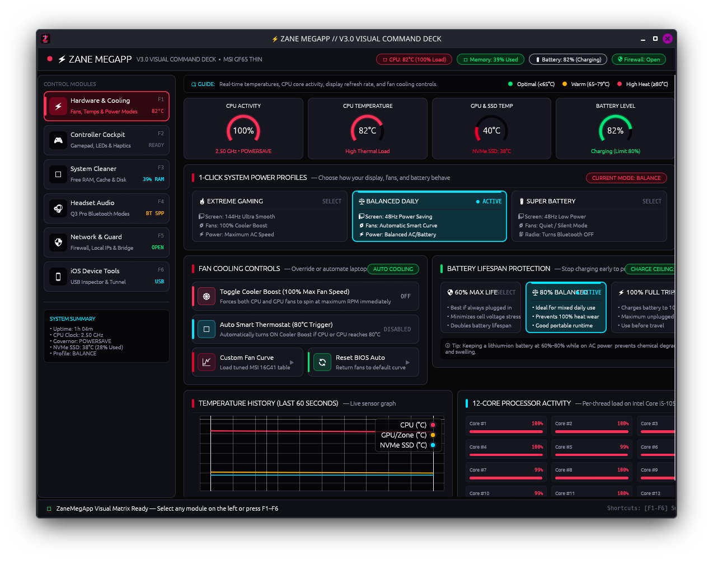

<div align="center">

```text
███████╗ █████╗ ███╗   ██╗███████╗    ███╗   ███╗███████╗ ██████╗  █████╗ ██████╗ ██████╗ 
╚══███╔╝██╔══██╗████╗  ██║██╔════╝    ████╗ ████║██╔════╝██╔════╝ ██╔══██╗██╔══██╗██╔══██╗
  ███╔╝ ███████║██╔██╗ ██║█████╗      ██╔████╔██║█████╗  ██║  ███╗███████║██████╔╝██████╔╝
 ███╔╝  ██╔══██║██║╚██╗██║██╔══╝      ██║╚██╔╝██║██╔══╝  ██║   ██║██╔══██║██╔═══╝ ██╔═══╝ 
███████╗██║  ██║██║ ╚████║███████╗    ██║ ╚═╝ ██║███████╗╚██████╔╝██║  ██║██║     ██║     
╚══════╝╚═╝  ╚═╝╚═╝  ╚═══╝╚══════╝    ╚═╝     ╚═╝╚══════╝ ╚═════╝ ╚═╝  ╚═╝╚═╝     ╚═╝     
               ⚡ C O R E   M A T R I X   //   R U S T   E D I T I O N ⚡
```

# ⚡ ZANE MEGAPP (V2 RUST) ⚡
### *Next-Gen Native System Matrix, Thermal Telemetry & Controller Space Cockpit*

[](https://www.rust-lang.org)
[](https://github.com/emilk/egui)
[](https://crates.io/crates/egui_plot)
[](#hardware-specs)
[](#display--compositor)
[](#privilege-architecture)

<br/>



<br/>

---

</div>

## 🛸 Overview

**ZaneMegApp (V2)** is a complete, from-scratch **Rust rewrite** of the original monolithic `ZaneMegaCenter.py`. Engineered with `eframe` (egui) and `egui_plot`, it replaces Python and CustomTkinter with a lightweight, multi-threaded native binary that executes with near-instantaneous startup, zero runtime interpreter overhead, and native GPU-accelerated rendering.

Designed for high-performance hardware tuning on the **MSI GF65 Thin** (and compatible Linux rigs), it unifies real-time EC thermal telemetry, fan speed curves, battery charge thresholds, asynchronous memory cleanup, and direct launcher integration with [**Controller Space**](https://github.com/ZaneGoat/Controler-space).

```text
┌────────────────────────────────────────────────────────────────────────────────────────┐
│                              ZANE MEGAPP // CORE COCKPIT MATRIX                        │
├──────────────────────────┬─────────────────────────────┬───────────────────────────────┤
│ ⚡ HARDWARE & POWER      │ 🎮 CONTROLLER SPACE         │ 🧹 SYSTEM CLEANER             │
│ • Realtime Thermal Plot  │ • Starship Flight Deck      │ • Smart RAM Optimizer         │
│ • Dual Fan Speeds & RPM  │ • 1000Hz Polling Matrix     │ • Zombie Reaping & Bloat Kill │
│ • Cooler Boost (pkexec)  │ • Haptics & LED Window      │ • Drop Caches & Swap Purge    │
│ • Battery Health (60/80) │ • Subprocess Live Telemetry │ • 12 Non-Blocking Modules     │
├──────────────────────────┼─────────────────────────────┼───────────────────────────────┤
│ 🎧 HEADSET CONTROLS      │ 🛡️ NETWORK ISOLATION        │ 📱 iDEVICE TOOLKIT            │
│ • SoundPEATS Q3 Pro      │ • UFW Firewall Matrix       │ • ideviceinfo Telemetry       │
│ • RFCOMM Socket Dispatch │ • Inbound Hardening Shield  │ • idevicesyslog Live Daemon   │
│ • [UNVERIFIED] Tagging   │ • Pentest Operational Notes │ • iproxy Port 2222 -> 22      │
└──────────────────────────┴─────────────────────────────┴───────────────────────────────┘
```

---

## ⚡ Key Modules

### 1. ⚡ Hardware & Power (`tab_hardware.rs`)
* **Realtime Thermal Telemetry Waveform**: Integrated GPU-rendered plot powered by `egui_plot`, displaying CPU (`#ff3333`) and GPU (`#ff8c8c`) temperatures over a rolling 60-second window.
* **Telemetry Badges**: Live readouts showing CPU temperature, fan speed percentage, GPU temperature, and cooling fan RPM via `/sys/class/thermal`, `/sys/class/hwmon`, and ISW dumps.
* **Power Profiles**:
  * **🔥 Extreme**: 144Hz high-refresh mode (`kscreen-doctor`), Bluetooth active, TLP AC mode, Cooler Boost engaged.
  * **⚖️ Balance**: 48Hz power-saving display mode, balanced fan curves, daily power profile.
  * **🔋 Super Battery**: 48Hz display refresh, Bluetooth radio blocked via `rfkill`, silent fan profile.
* **Cooler Boost & Smart Thermostat**: Direct hardware trigger overriding the Embedded Controller to run fans at 100% maximum RPM. Features an auto-engaging Smart Boost thermostat when thermals exceed **80°C**.
* **Battery Longevity Cap**: Caps maximum AC charging threshold directly in the Embedded Controller (60% Max Life, 80% Balanced, 100% Full Trip).

### 2. 🎮 Controller Space // Starship Cockpit (`tab_controller.rs`)
* **Flight Deck Launcher**: 1-click execution for `~/Desktop/Controler space/start.sh` (or fallback `~/controller-dashboard/start.sh`).
* **Process Lifecycle Matrix**: Real-time PID tracking with Start, Stop, and Restart controls.
* **Subsystem Shortcuts**:
  * Direct link to GitHub repository (`ZaneGoat/Controler-space`).
  * Direct folder opener (`xdg-open`).
  * Dedicated LED & Rumble window launcher (`python3 led.py`).
* **Console Telemetry**: Streaming, auto-scrolling terminal output capturing child process stdout and stderr in real time.

### 3. 🧹 High-Efficiency System Cleaner (`tab_cleaner.rs`)
* **Non-Blocking Threaded Engine**: Cleanup tasks execute in an isolated background thread communicating over `std::sync::mpsc` channels, preventing any UI stutter.
* **12 Dedicated Optimization Modules**:
  1. **🧠 Smart RAM Optimizer**: Scans `/proc` to safely terminate background bloatware (`tracker-miner`, `baloo_file`, `evolution-data`, `xdg-desktop-portal`), cleans zombie processes, and stops heavy user services.
  2. **🧠 RAM Kernel Cache Flush**: `sync && echo 3 > /proc/sys/vm/drop_caches && sysctl -w vm.compact_memory=1`.
  3. **⚙️ Background Service Optimizer**: Stops non-essential system daemons (`cups`, `ModemManager`, `avahi-daemon`).
  4. **Swap Memory Reset**: `swapoff -a && swapon -a`.
  5. **APT Package Cache**: Purges orphaned packages and cache (`apt-get clean && autoremove`).
  6. **Python Pip Cache**: `pip cache purge`.
  7. **Systemd Journal Logs**: Vacuums journal storage down to 100M.
  8. **User Trash Bin**: Empties `~/.local/share/Trash`.
  9. **Thumbnail Cache**: Clears `~/.cache/thumbnails`.
  10. **Flatpak Unused**: Prunes unreferenced Flatpak runtimes.
  11. **Docker Prune**: Prunes stopped containers and dangling images.
  12. **/tmp Old Files**: Purges temporary files older than 24 hours.

### 4. 🎧 Headset RFCOMM Controller (`tab_headset.rs`)
* **Bluetooth SPP Dispatch**: Manages RFCOMM connections to SoundPEATS Q3 Pro (`41:42:F0:AC:0F:EF`).
* **⚠️ Honesty & Protocol Integrity**: All mode payloads (`noise_cancelation`, `ambient`, `normal`, `disable_controls`, `movie_mode`) are explicitly labeled **`UNVERIFIED`**.
* **Reverse-Engineering Roadmap**: Outlines instructions for capturing Android Bluetooth HCI Snoop logs with Wireshark to extract genuine vendor payloads.

### 5. 🛡️ Network Isolation Matrix (`tab_security.rs`)
* **UFW Firewall Hardening**: Single-click toggle between active isolation and open mode using `pkexec`.
* **Desktop Notifications**: Dispatches native notifications via `notify-send`.
* **⚠️ Penetration Testing Advisories**: Explicitly documents services that inbound default-deny will disrupt (reverse shells, Metasploit handlers, Responder, local HTTP staging) with instant revert commands (`pkexec ufw disable`).

### 6. 📱 iOS iDevice Toolkit (`tab_idevice.rs`)
* **Hardware Telemetry**: Queries USB connected iOS device status via `ideviceinfo`.
* **Console Streaming Daemon**: Spawns and manages continuous live logging via `idevicesyslog`.
* **SSH Tunnel Proxy**: Forwards local port `2222` to device port `22` over USB cable using `iproxy`.
* **Pairing Validation**: One-click pairing verification (`idevicepair pair` & `idevicepair validate`).

---

## 🏗️ Architecture & Codebase Layout

```text
/home/zane/Desktop/ZaneMegApp/
├── Cargo.toml                  # Dependencies (eframe 0.36, egui_plot 0.37)
├── Cargo.lock                  # Pinned dependency graph
├── run.sh                      # Instant launcher for the release binary
├── resume_agent.sh             # Quick-resume script for Antigravity AI agent
├── PROJECT_STATE.md            # Persistent state documentation
├── python_prototype/           # Archived Python modules for reference
└── src/
    ├── main.rs                 # Native viewport entry point
    ├── app.rs                  # eframe::App implementation & header navigation
    ├── theme.rs                # Dark cyber-red palette & visual styling
    ├── core/                   # Pure backend logic
    │   ├── mod.rs
    │   ├── hardware.rs         # ISW fan control, battery caps, power modes
    │   ├── cleaner.rs          # 12 cleanup modules & background worker channels
    │   ├── controller.rs       # Controller Space lifecycle & process tracking
    │   ├── headset.rs          # RFCOMM socket caller & UNVERIFIED parser
    │   ├── security.rs         # UFW state queries & toggle via pkexec
    │   └── idevice.rs          # iOS daemon streams & USB proxying
    └── ui/                     # Modular frontend tabs
        ├── mod.rs              # AppTab navigation enum
        ├── tab_hardware.rs     # Thermal plot & fan curves
        ├── tab_cleaner.rs      # Module checkboxes & execution terminal
        ├── tab_controller.rs   # Starship deck controls & live log
        ├── tab_headset.rs      # Earbuds controls & protocol warning banner
        ├── tab_security.rs     # Isolation switch & pentest notices
        └── tab_idevice.rs      # iOS device utilities & console
```

---

## 🚀 Building & Running

### Prerequisites
* **Rust Toolchain**: Rust 1.95+ (`cargo`, `rustc`).
* **Linux Graphics**: Wayland or X11 compositor with OpenGL / Vulkan drivers.

### 1-Click Launch (Release Binary)
```bash
cd /home/zane/Desktop/ZaneMegApp
./run.sh
```

### Manual Compilation
```bash
# Build optimized release binary
cargo build --release

# Run directly
./target/release/zanemegapp
```

---

## 🔒 Security & Privilege Rules

* **No TTY Privilege Elevation**: Privileged actions use `pkexec` (Polkit GUI authentication prompt) rather than blocking `sudo` commands.
* **Non-Blocking Subprocesses**: All external runners (`isw`, `tlp`, `apt-get`, `idevicesyslog`) are executed asynchronously on background threads so the GUI frame rate remains locked at smooth rendering.
* **Reversibility**: Firewall changes can be reverted at any moment using the in-app toggle or `pkexec ufw disable`.

---

<div align="center">

```text
  [ ZANE MEGAPP ] ──► [ RUST ENGINE ] ──► [ NATIVE KERNEL / EC ]
        ▲                      │
        └────── egui_plot ─────┘
```

*Built by **ZaneGoat** // Powered by Rust & Antigravity*

</div>
